# 模板预览

| 模板 | 输入 | 预览 |
|---|---|---|
| 馒头社交电量 / `mantou_battery` | 1 张头像 | 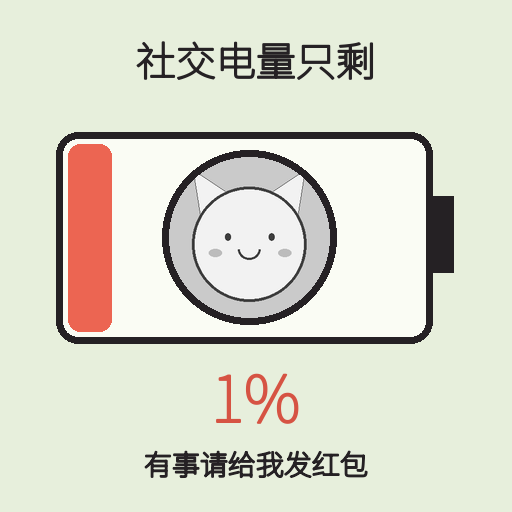 |
| 馒头正在红温 / `mantou_overheat` | 1 张头像 | 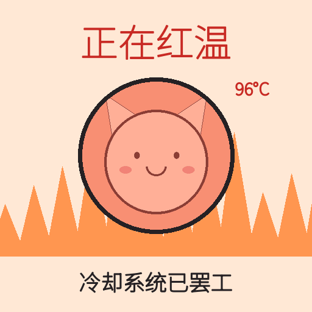 |
| 馒头脑子加载中 / `mantou_loading` | 1 张头像 | 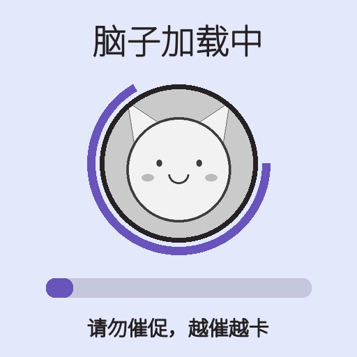 |
| 馒头本人已下线 / `mantou_offline` | 1 张头像 | 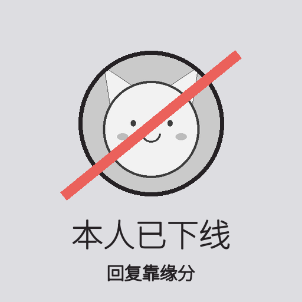 |
| 馒头摸鱼工牌 / `mantou_work` | 1 张头像 | 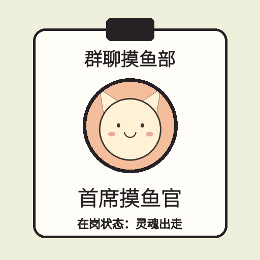 |
| 馒头精神工资条 / `mantou_salary` | 1 段文字 | 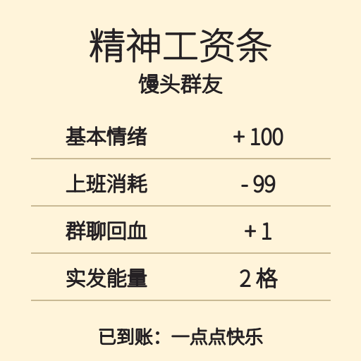 |
| 馒头已读乱回小票 / `mantou_receipt` | 1 段文字 |  |
| 馒头夸夸奖状 / `mantou_praise` | 1 张头像 |  |
| 馒头头上长草 / `mantou_grass` | 1 张头像 |  |
| 馒头满头问号 / `mantou_question` | 1 张头像 |  |
| 馒头水豚泡汤 / `mantou_capybara` | 1 张头像 |  |
| 馒头猫猫探头 / `mantou_cat` | 1 张头像 | 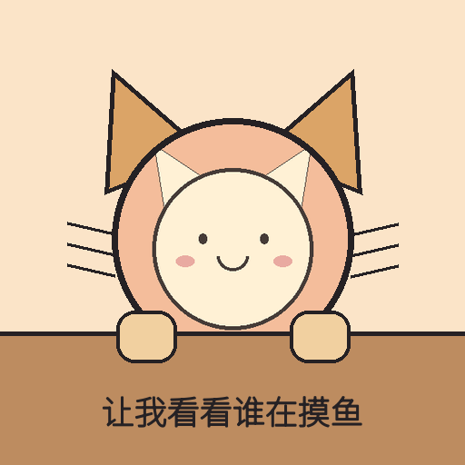 |
| 馒头蒸笼认领 / `mantou_bun` | 1 张头像 | 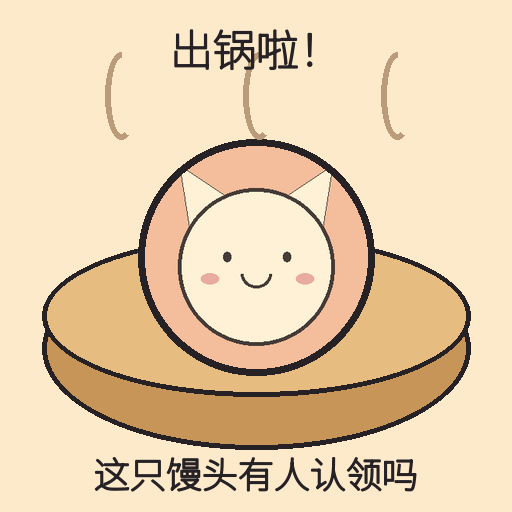 |
| 馒头今日桃气 / `mantou_peach` | 1 张头像 | 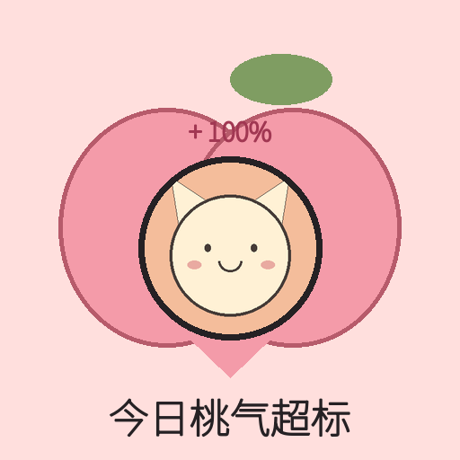 |
| 馒头双人应援 / `mantou_support` | 2 张头像 |  |
| 馒头给你充电 / `mantou_charge` | 2 张头像 | 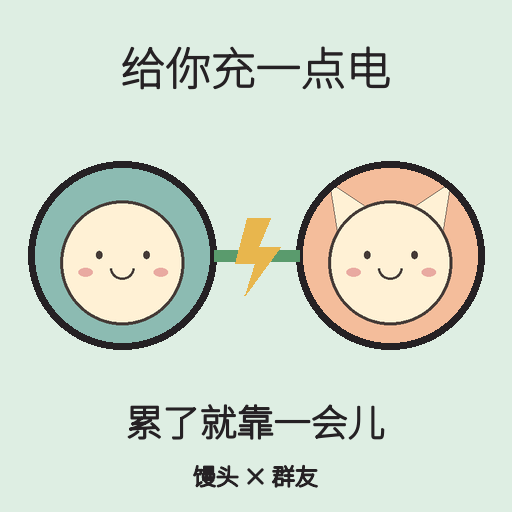 |
| 馒头菜鸡对决 / `mantou_duel` | 2 张头像 |  |
| 馒头吃瓜席位 / `mantou_melon` | 1 张头像 | 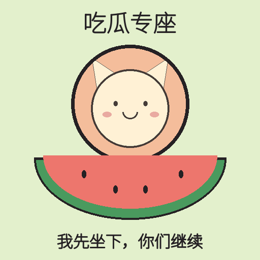 |
| 馒头关机睡觉 / `mantou_sleep` | 1 张头像 |  |
| 馒头今日摆烂计划 / `mantou_schedule` | 1 段文字 | 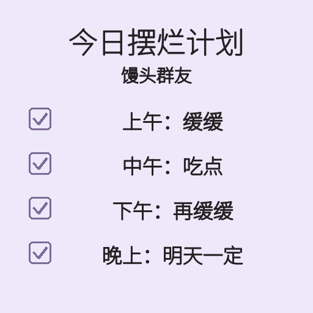 |
