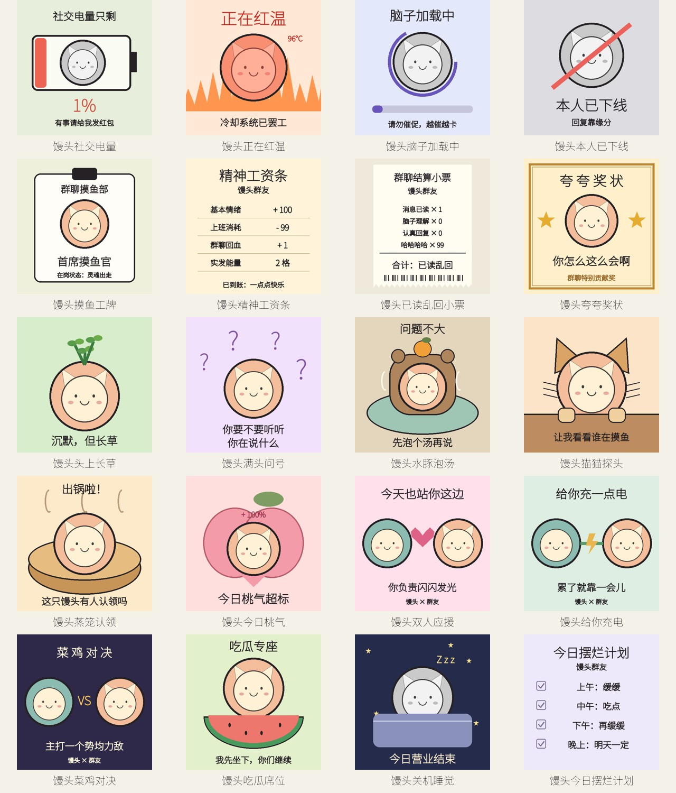

# mantou-memes

适用于 [MemeCrafters/meme-generator](https://github.com/MemeCrafters/meme-generator) **0.1.14 / 0.1.x** 的独立表情模板库。首批 **20 个模板：18 个 PNG、2 个循环 GIF**，涵盖打工摸鱼、抽象情绪、猫猫水豚、群聊围观、游戏对战和馒头桃子。

模板会真正替换输入头像或文字，不是只能转发的成品图库。通过上游公开的 `add_meme` 注册、`load_memes` 加载；无需 fork 或修改生成器。所有键名带 `mantou_` 前缀，避免和现有库撞名。



完整动图和单张预览：[CATALOG.md](CATALOG.md)。选题来源、首批范围与后续候选：[主题调研](docs/themes.md)。

## 使用

需要 Python 3.9+，使用 Python 版 `meme-generator`，不是 `meme-generator-rs`。

```bash
git clone https://github.com/TonyLiangP2010405/mantou-memes.git
cd mantou-memes
python -m pip install -r requirements.txt
```

Python 中使用（从项目根目录运行）：

```python
from pathlib import Path
from meme_generator import get_meme, load_memes

load_memes(Path("memes").resolve())

# 单头像模板；也可传图片字节或 BytesIO。
result = get_meme("mantou_battery")(images=[Path("avatar.png")])
Path("result.png").write_bytes(result.getvalue())

# 纯文字模板。
result = get_meme("mantou_receipt")(texts=["群友昵称"])
Path("receipt.png").write_bytes(result.getvalue())

# 双头像模板：第一张在左，第二张在右。
result = get_meme("mantou_charge")(images=[Path("bot.png"), Path("friend.png")])
Path("charge.png").write_bytes(result.getvalue())

# 动图：mantou_overheat / mantou_loading。
result = get_meme("mantou_loading")(images=[Path("avatar.png")])
Path("loading.gif").write_bytes(result.getvalue())
```

也可以在上游生成器的 `config.toml` 中，把本仓库 **`memes` 目录的绝对路径**加入 `[meme].meme_dirs`；保留你已有的其他目录。

```toml
[meme]
meme_dirs = ["/path/to/mantou-memes/memes"]
```

关键词、参数数量、标签见 [模板目录](CATALOG.md)。通过机器人命令调用需要机器人端的 memes 插件支持，模板库本身不注册 NoneBot 命令。

## 馒头好感度插件

配套的 [nonebot-plugin-mantou-affection](https://github.com/TonyLiangP2010405/nonebot-plugin-mantou-affection) 可以通过外部仓库加载器下载本库的 `memes/` 目录。转盘原有规则可直接使用全部 20 个模板：

- 纯文字：参与者群昵称。
- 单头像：参与者头像。
- 双头像：机器人头像在左，参与者头像在右。
- 仍遵循插件的表情确认、免确认白名单、屏蔽词和失败提示。

本库包含完整中文字体；模板素材由代码绘制，本库自身加载后不需要额外下载字体或背景图。头像输入仍由调用方提供，插件获取 QQ 头像需要网络。上游内置模板的资源下载机制与本库独立。

## 开发与验证

```bash
python -m pip install -r requirements-dev.txt
python -m pytest -q
ruff check .
python tools/generate_previews.py
```

测试通过**真实的上游 `load_memes` 和 `Meme.__call__`**检查注册及输出，覆盖全部模板的 PNG/GIF 解码、长昵称、透明/极小/纵向/JPEG 输入、双头像顺序和非法参数。测试与预览脚本使用临时配置，不会加载用户的第三方模板，也不发起网络请求。

新增模板在 `memes/mantou/__init__.py` 的 `TEMPLATES` 中声明，并实现对应的绘制分支；同步更新模板数量断言、测试、预览和目录。每个模板保持 512×512，输入限制为 1 段文字、1 张头像或 2 张头像之一，不需要强制附加参数。字体不支持的字符（例如部分彩色 emoji）可能显示为缺字框，常用简体中文、拉丁字母和数字可用。

## 许可与来源

代码、程序绘制的模板构图、示例头像及预览图采用 [MIT](LICENSE)。主题参考公开的群聊使用场景，未打包网络搜到的表情原图、影视截图或角色素材。使用者传入的头像归其相应权利人所有。

随库字体 [Noto Sans SC](https://github.com/google/fonts/tree/main/ofl/notosanssc) 由 Google Fonts 提供，单独遵循 [SIL Open Font License 1.1](memes/mantou/OFL.txt)。原始字体未修改，SHA256：`a3041811a78c361b1de50f953c805e0244951c21c5bd412f7232ef0d899af0da`。完整字体约 17 MiB，保留字库以支持用户自定义中文昵称。
