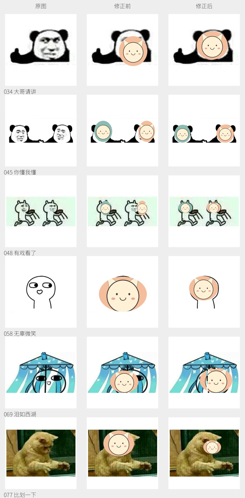

# 头像对齐复核

2026-10-24 对 `mantou_duel_001` 至 `mantou_duel_100` 的原图、纯色遮罩合成图和示例头像合成图进行了人工复核；检查了全部 7 个 GIF 的 43 个已收录帧。原图素材与裁切范围未改动，本次调整头像位置及前景遮挡。

本次重新校准了 87 个模板的坐标，为 23 个模板增加前景保护，共调整 89 个模板的定义。双头像 `045`、`048` 分别校准左右两张脸；`097`、`098`、`099` 按帧设置位置。旋转头像先在正方形内旋转，再映射到椭圆，避免扩展画布后产生白色三角。

下图从左到右为原图、修正前、修正后，选择了偏位明显的 6 个例子：

全部效果见 [新增 100 个模板目录](../DUEL_CATALOG.md)。目录中的 GIF 可打开查看完整动作，总览页只显示首帧。

回归测试包含 22 组独立取自原图的眼睛、嘴巴、身体、手势及道具坐标，另检查滚动动图每帧的头像边缘覆盖。它们用于防止已知偏位复发，不代表自动识别或验证了所有原图的人脸边界；模板位置与遮挡边缘仍需人工查看合成图。

前景保护多边形位于各张脸的 `preserve` 字段，坐标基于已裁切的素材，和 `box` 使用同一坐标系。它们使原图中的手、帽子或道具保留在头像上层；动态模板可在 `frame_faces` 中逐帧配置。调整素材裁切后必须同时重算这些坐标。

已有机器人缓存需要按 [README 的更新说明](../README.md#馒头好感度插件) 重新下载本库后重启。
